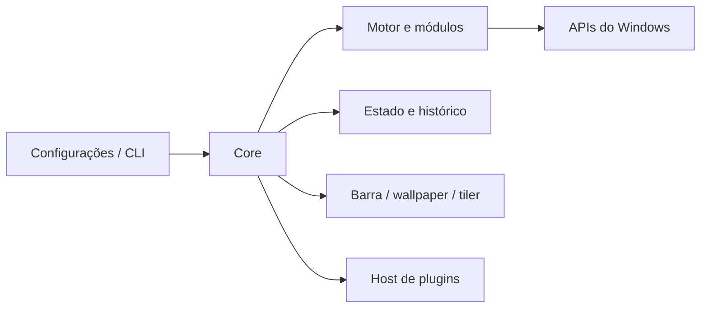

# Visão técnica

O Ricing Manager aplica um conjunto de preferências e arquivos chamado *rice* ao Windows. A interface e a CLI encaminham operações ao core; módulos traduzem os campos do rice em alterações do sistema. Componentes para barra, vídeo, tiling e plugins têm processos próprios. Os contratos e decisões originais estão em [03 — Arquitetura](03-arquitetura.md); esta página é um mapa para navegar na implementação.

## Estrutura

| Caminho | Responsabilidade |
|---|---|
| [apps/](../apps/) | executáveis: core, CLI, configurações, barra, wallpaper, tiler, host de plugins e componente elevado |
| [libs/domain/](../libs/domain/) · [libs/engine/](../libs/engine/) | modelos e coordenação das operações |
| [libs/modules/](../libs/modules/) · [libs/platform/](../libs/platform/) | módulos de personalização e integração com Windows |
| [libs/ipc/](../libs/ipc/) · [libs/client/](../libs/client/) | comunicação e cliente do core |
| [libs/storage/](../libs/storage/) · [libs/package/](../libs/package/) | persistência e pacotes |
| [libs/plugins/](../libs/plugins/) · [libs/scripting/](../libs/scripting/) | plugins e execução de scripts |
| [rices/](../rices/) · [plugins/](../plugins/) | rices oficiais, exemplos e template de plugin |
| [tests/](../tests/) · [scripts/](../scripts/) | testes e ferramentas de desenvolvimento |



O diagrama resume responsabilidades, não todas as conexões entre processos. A descrição dos limites e contratos está no [doc 03](03-arquitetura.md) e as decisões específicas nos [ADRs](adr/).

## Aplicação e restauração

Um rice contém `rice.toml` e seus assets. `rmw validate <pasta>` verifica o arquivo; `rmw apply <pasta>` inicia a aplicação. O motor captura o estado anterior, planeja e aplica as alterações por módulo, mantendo histórico para desfazer. `rmw history` mostra operações; `rmw restore --snapshot <id>` retorna ao estado anterior à operação escolhida e `rmw restore --original` solicita o original. Mudanças feitas pela pessoa fora do aplicativo podem deixar de ser gerenciadas; `--force` força a restauração. Consulte o [guia](user-guide.md) antes de operar.

O original acompanha os valores da pessoa quando um campo volta a ser assumido pelo aplicativo. Uma cópia fica ao lado do diretório de dados, como `RicingManagerWindows.original.json`; preservá-la importa quando os dados são removidos com um rice aplicado. Arquivos originais que desapareceram podem limitar a restauração. O comportamento e suas limitações estão no [ADR-0026](adr/0026-o-windows-da-pessoa.md) e no [plano v1.9](17-plano-v1.9.md).

Na tela de bloqueio, a imagem armazenada para a opção Imagem é restaurada antes de religar o Destaque, pois definir uma imagem desliga o Destaque. A regressão está em [LockScreenTests.cpp](../tests/unit/LockScreenTests.cpp); alterações reais do Windows exigem também a suíte de sistema.

## Desenvolvimento e verificação

No Windows, instale os componentes indicados no [README](../README.md#compilar), incluindo MSVC, bibliotecas Spectre, Clang e vcpkg. A partir da raiz:

```powershell
.\scripts\build.ps1 -Preset debug -Test
.\scripts\build.ps1 -Preset asan -Test
.\scripts\sandbox.ps1 -Preset debug -Suite system
.\scripts\format.ps1
```

Os testes unitários usam interfaces e substitutos para exercitar a lógica; não comprovam que APIs e configurações reais do Windows tenham sido restauradas. A suíte `system` executa alterações no Windows Sandbox descartável, com saída em `build\sandbox\debug\`. Veja [tests/system/README.md](../tests/system/README.md) e [docs/08](08-engenharia-build-testes-ci.md) para outras suítes, requisitos e limites. Resultados antigos no diário não substituem uma execução para a alteração atual.

## Dados e diagnóstico

Por padrão, dados do usuário ficam em `%LOCALAPPDATA%\RicingManagerWindows`; instalação por usuário em `%LOCALAPPDATA%\Programs\Ricing Manager`. A página Diagnóstico apresenta processos e problemas recentes e permite criar um pacote de suporte. `rmw status` mostra o estado gerenciado; o guia também explica modo seguro, recuperação da barra e desinstalação. Ao compartilhar logs ou pacotes de suporte, revise-os para não expor caminhos ou informações pessoais.
