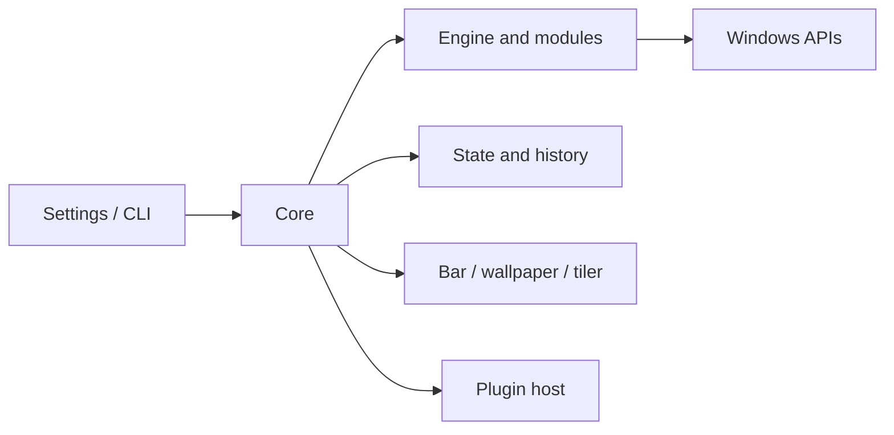

# Technical overview

> [Português](../arquitetura-atual.md) · [Documentation index](README.md)

Ricing Manager applies a set of preferences and assets called a *rice* to Windows. The settings interface and CLI send operations to the core; modules translate rice fields into system changes. The bar, video, tiling, and plugins have separate processes. The original contracts and decisions are in [Architecture](../03-arquitetura.md) (Portuguese); this page maps the implementation.

## Repository structure

| Path | Responsibility |
|---|---|
| [apps/](../../apps/) | Executables: core, CLI, settings, bar, wallpaper, tiler, plugin host, and elevated component |
| [libs/domain/](../../libs/domain/) · [libs/engine/](../../libs/engine/) | Models and operation coordination |
| [libs/modules/](../../libs/modules/) · [libs/platform/](../../libs/platform/) | Customization modules and Windows integration |
| [libs/ipc/](../../libs/ipc/) · [libs/client/](../../libs/client/) | Communication and core client |
| [libs/storage/](../../libs/storage/) · [libs/package/](../../libs/package/) | Persistence and packages |
| [libs/plugins/](../../libs/plugins/) · [libs/scripting/](../../libs/scripting/) | Plugins and script execution |
| [rices/](../../rices/) · [plugins/](../../plugins/) | Official rices, examples, and plugin template |
| [tests/](../../tests/) · [scripts/](../../scripts/) | Tests and development tools |



The diagram summarizes responsibilities rather than every connection. See the original [architecture](../03-arquitetura.md) and [ADRs](../adr/) for contracts and individual decisions.

## Application and restoration

A rice contains `rice.toml` and its assets. `rmw validate <folder>` checks it; `rmw apply <folder>` applies it. The engine captures the previous state, plans and applies changes by module, and keeps history for undo. `rmw history` lists operations; `rmw restore --snapshot <id>` returns to the state before the selected operation, while `rmw restore --original` requests the original state. Changes made outside the application can stop being managed; `--force` forces restoration. Read the [user guide](../user-guide.md) before operating.

The original follows the person's values when the application takes control of a field again. A copy is stored next to the data directory as `RicingManagerWindows.original.json`; retaining it matters when data is removed while a rice is applied. Missing original files can limit restoration. See [ADR-0026](../adr/0026-o-windows-da-pessoa.md) and the [v1.9 plan](../17-plano-v1.9.md) (Portuguese) for behavior and limits.

For the lock screen, the image stored for Picture is restored before Spotlight is turned back on, because setting an image disables Spotlight. The regression is covered by [LockScreenTests.cpp](../../tests/unit/LockScreenTests.cpp); actual Windows changes also require the system suite.

## Development and verification

On Windows, install the components in the [README](../../README.md#build), including MSVC, Spectre libraries, Clang, and vcpkg. From the repository root:

```powershell
.\scripts\build.ps1 -Preset debug -Test
.\scripts\build.ps1 -Preset asan -Test
.\scripts\sandbox.ps1 -Preset debug -Suite system
.\scripts\format.ps1
```

Unit tests use interfaces and substitutes to exercise logic; they do not prove that real Windows APIs and settings were restored. The `system` suite makes changes in disposable Windows Sandbox, with output in `build\sandbox\debug\`. See [system tests](../../tests/system/README.md) and [engineering](../08-engenharia-build-testes-ci.md) (Portuguese) for other suites, requirements, and limits. Old results in the journal do not replace a run for the current change.

## Data and diagnostics

By default, user data lives in `%LOCALAPPDATA%\RicingManagerWindows`; the per-user installation is in `%LOCALAPPDATA%\Programs\Ricing Manager`. The Diagnostics page shows processes and recent problems and can create a support bundle. `rmw status` shows managed state; the guide also explains safe mode, bar recovery, and uninstalling. Review logs and support bundles before sharing them to avoid exposing paths or personal information.
